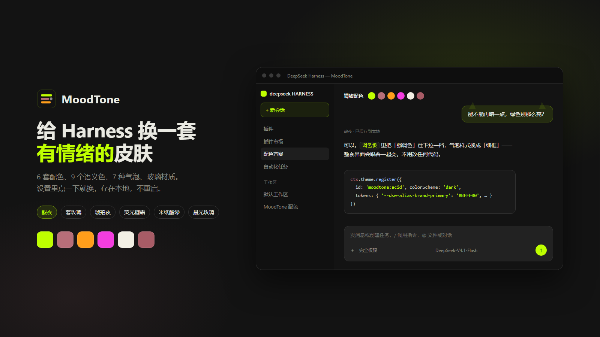
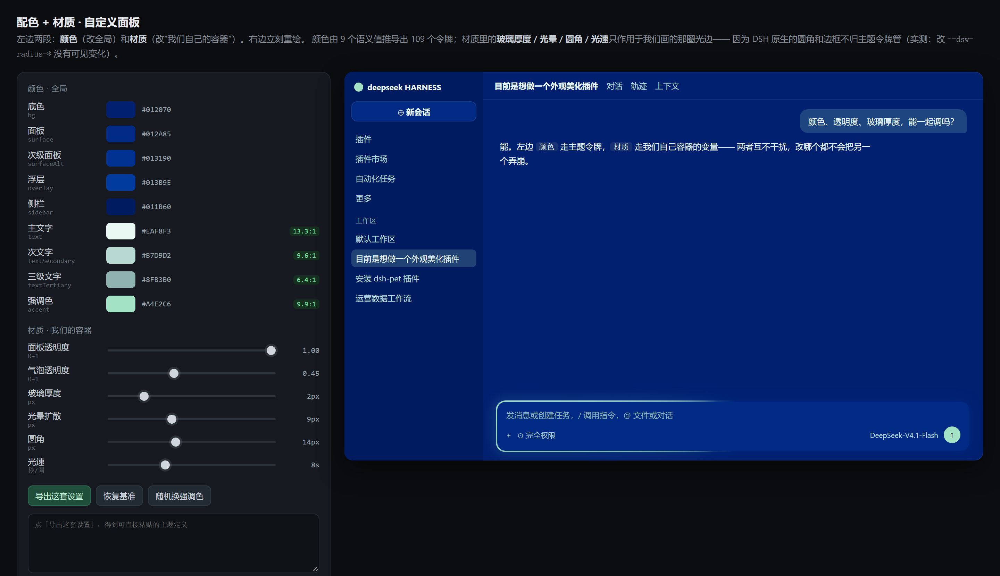
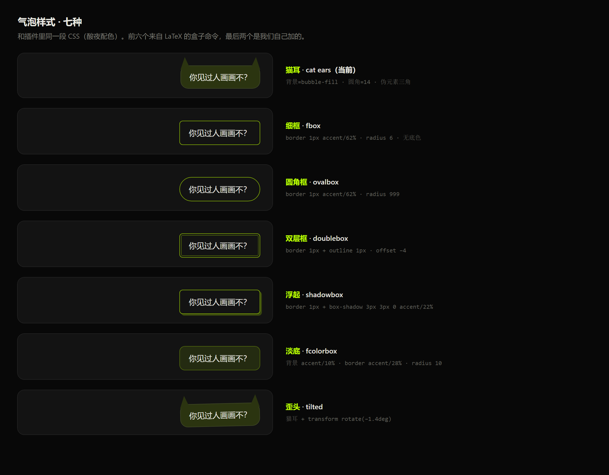

# MoodTone · 给 DeepSeek Harness 换一套有情绪的皮肤

[](docs/cover.png)

**一句话**：6 套情绪配色、9 个语义色随手改、7 种气泡样式、玻璃材质——全部在「设置 → 配色方案」里点，存在本地，不重启。

---

## 为什么不是又一套「深色主题」

大部分换肤插件只给你两三套固定颜色，用完就腻；真给你 118 个 CSS 变量，你改到第 60 个的时候界面一定会崩。

MoodTone 的做法是：**只把 9 个语义值交给你**（底色、面板、次级面板、浮层、侧栏、主文字、次文字、三级文字、强调色），剩下 109 个令牌由它们推导出来。

这意味着：

- 你怎么调，**都不会把界面改崩**（白字白底、按钮消失这类事故结构上不可能发生）；
- 改一个颜色，**整个界面立刻重算**：代码块底色、diff 行、hover 态、滚动条、开关、弹层，全会跟着走；
- 每个文字色旁边**实时算对比度**，低于阈值标红——不用懂 WCAG，红的就是看不清。

---

## 六套配色

| | 名称 | 方案 | 底色 | 强调色 | 适合 |
|---|---|---|---|---|---|
| 🟩 | **酸夜** acid night | 深色 | `#131313` | `#BFFF00` | 默认。终端感、高对比，长时间看不困 |
| 🌹 | **暮玫瑰** rose ink | 深色 | `#141414` | `#B76E79` | 低调的暖调，比纯灰多一口气 |
| 🟠 | **琥珀夜** amber night | 深色 | `#100C07` | `#FF9E1B` | 夜里像一盏台灯 |
| 🟣 | **荧光糖霜** candy neon | 深色 | `#0E0A10` | `#F43DDF` | 想要一点点赛博 |
| 📄 | **米纸酸绿** paper lime | 浅色 | `#F3F0E5` | `#BFFF00` | 白天用，米纸底不刺眼 |
| 🌷 | **晨光玫瑰** rose dawn | 浅色 | `#F5EEEB` | `#A85C66` | 白天用，最柔和的一套 |

每套只有 7 个原始色值（底色/面板/次级面板/边框/文字/次文字/强调色），其余全部按规则推导，所以六套之间既统一又各有性格。

---

## 三个可玩的地方

### 1. 调色板：9 个语义色



点色块即改，右侧实时预览。改完点「导出这套配色」，会给你一段可直接粘贴的 `theme.register` 代码——**自己调出来的配色，能变成能分享的主题**。

### 2. 气泡样式：7 种



猫耳 / 细框 / 圆角框 / 双层框 / 浮起 / 淡底 / 歪头。

猫耳是默认的，也是这套插件最早的样子：两只耳朵长在气泡的角上，和泡体是**同一个轮廓**（实色填充 + 尖角内收 42%），不是贴上去的两个三角形。

细框、圆角框、双层框、浮起这四种来自 LaTeX 的 `\fbox` / `\ovalbox` / `\doublebox` / `\shadowbox`——把排版里那些「盒子」的克制感搬到对话框上。

### 3. 材质：5 个滑块

面板透明度 / 背景模糊 / 描边厚度 / 圆角 / 猫耳高度。

> ⚠️ **背景模糊默认是 0**。磨砂在「文字很多的界面」上很容易糊成一片，所以我们把它做成默认关闭、你自己拧开。要玻璃感就把「背景模糊」拉到 8–12px，配合「面板透明度」0.85 左右。

---

## 安装

```bash
npx @deepseek-ai/dsh plugin --profile web add moodtone
```

装完重启 Harness。入口在 **设置 → 配色方案**（左侧列表里，Agent 预设下面）。

不用命令行的话，也可以在插件市场里搜索 `MoodTone`。

---

## 边界（先说清楚，免得你以为是 bug）

| 能改 | 不能改 |
|---|---|
| 界面全部颜色（118 个设计令牌） | Electron 原生菜单栏（应用 / 编辑） |
| 用户气泡的样式与材质 | DSH 组件的圆角（不走设计令牌，实测无效） |
| 我们自己画的容器（玻璃、描边） | 第三方插件自己写死的颜色 |
| 主题切换、持久化 | 助手气泡的外观（它是渲染器，不只是个 div） |

另外：**颜色能全局，材质只能作用于我们的容器**。这是 DSH 主题系统的边界，不是偷懒。

---

## 数据与隐私

- 所有配置存在浏览器 `localStorage`（键前缀 `moodtone:`）；
- **没有任何网络请求**，不上报、不统计、不下载远程资源；
- 卸载插件后，`localStorage` 里的几个键留在原处（不占空间，也不影响 DSH 运行），想清干净在控制台 `Object.keys(localStorage).filter(k=>k.startsWith('moodtone:'))` 删掉即可；
- 插件被禁用/卸载时，会主动把主题偏好复位到内置的浅色/深色，**不会留下一个指向不存在主题的 preference**（这是很多人换肤插件卸载后界面变成白屏的原因）。

---

## 想自己改

```
pkg/moodtone/
├── client.js          # 全部逻辑：配色表 SPECS、令牌推导 buildTokens、设置页 PaletteSection
├── index.js           # Host 半体（空实现，渲染全在 Client）
├── cordis.patch.yml   # 插件行声明
├── locale/{zh,en}.json# 插件列表里的标题与简介
├── icon.svg           # 市场/插件列表图标
└── docs/              # 封面与文档配图
```

改配色只动 `client.js` 里的 `SPECS`（每套 10 个字段）；改默认主题动 `DEFAULT_THEME`；改材质默认值动 `MAT_DEFAULT`。文件顶部有注释标了「改这里就够了」。

改完不用重新安装——DSH 的插件是 junction 链接的，保存即热重载；没生效就 `Ctrl+R` 重载页面。

---

## License

MIT

---

<sub>MoodTone 是 [DeepSeek Harness](https://github.com/deepseek-ai) 的第三方皮肤插件，与官方无隶属关系。</sub>
